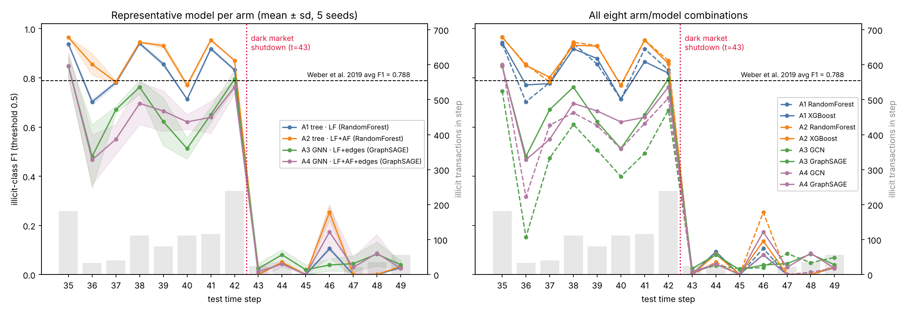

# Illicit Bitcoin Transaction Detection on the Elliptic Dataset

BCSE209L Machine Learning, VIT Vellore (SCOPE). ADITHIYA SR (23BDS0045), SHRIJANKIRITH T (23BDS0034), RAJITA SK (23BDS0010)

This repository implements the system from the project demonstration deck. It covers the frozen temporal split,
separate local (LF) and aggregated (AF) feature blocks, a test of the elliptical-distribution assumption, four
controlled detection arms × 2 models × 5 seeds, and illicit-class evaluation at every test time step, before and
after the dark-market shutdown at t = 43.

## Quick start

```bash
pip install -r requirements.txt
python scripts/download_data.py          # or put the Kaggle CSVs in data/raw/ (see data/README.md)
python run_experiments.py --quick        # ~4 min smoke test
python run_experiments.py                # full protocol, ~2 h on a 2-core laptop CPU
jupyter notebook notebooks/Elliptic_Illicit_Detection.ipynb
```

The notebook comes already executed. It reads the saved predictions by default; set `RUN_TRAINING = True` to retrain.

## Results (test period t35–49, mean ± sd over 5 seeds, threshold 0.5)

| Arm | Model | Input | Illicit F1 | PR-AUC | F1 t35–42 | F1 t43–49 |
|---|---|---|---|---|---|---|
| A1 | Random Forest | LF | 0.743 ± 0.001 | 0.789 | 0.835 | 0.026 |
| A1 | XGBoost | LF | 0.743 ± 0.005 | 0.784 | 0.836 | 0.029 |
| A2 | **Random Forest** | LF+AF | **0.808 ± 0.004** | 0.798 | 0.884 | 0.048 |
| A2 | XGBoost | LF+AF | 0.792 ± 0.007 | 0.801 | 0.883 | 0.036 |
| A3 | GraphSAGE | LF+edges | 0.557 ± 0.044 | 0.669 | 0.668 | 0.047 |
| A3 | GCN | LF+edges | 0.381 ± 0.045 | 0.408 | 0.506 | 0.043 |
| A4 | GraphSAGE | LF+AF+edges | 0.615 ± 0.055 | 0.588 | 0.656 | 0.053 |
| A4 | GCN | LF+AF+edges | 0.591 ± 0.025 | 0.628 | 0.611 | 0.024 |
| A2 | XGBoost + NCL-SMOTE | LF+AF | 0.814 ± 0.004 | 0.816 | 0.898 | 0.041 |

Published baselines: Weber et al. 2019 RF F1 0.788 (our A2 RF: 0.808). Oliveira et al. 2021 reported F1 < 0.25 after t43
(ours: 0.02–0.05 for every arm).



Key findings, with full reasoning in the notebook's Conclusions:
1. The elliptical assumption is rejected (KS = 0.75). Mahalanobis distance as a detector scores *below* random
   (PR-AUC 0.038 vs 0.065), so the system needs supervision.
2. The 72 aggregated features add about +0.05–0.07 F1 to tree models (A2 vs A1).
3. Learned message passing does not beat precomputed aggregates. Every GNN arm is below even the no-graph tree baseline.
4. Every arm collapses after t = 43. Feature-block attribution barely moves (about 64/36 LF/AF before and after),
   so the models keep using the same evidence, and that evidence stops separating the new illicit activity.

## Layout

```
src/config.py        frozen split, windows, seeds, threshold, block sizes
src/data.py          load (Kaggle or Elliptic++), integrity checks, label mapping, train-only scaling, LF/AF blocks
src/elliptical.py    Mahalanobis / chi-square test, PCA ellipse, Q-Q plot, distance histogram, d^2 as detector
src/models.py        four arms; XGBoost, Random Forest, GraphSAGE, GCN; shared class weight; NCL-SMOTE
src/experiment.py    tuning on t1-28 -> t29-34, 5-seed training on t1-34, saves predictions + seed-0 models
src/analysis.py      per-time-step metrics, confusion matrices, pre/post table, drift + PR figures,
                     SHAP / gradient x input block attribution, ranked alert list
src/trace.py         traces one real transaction through every stage (slide 8)
run_experiments.py   command-line driver
notebooks/           annotated, executed end-to-end notebook (+ HTML export)
results/tables/      every reported number as CSV
results/figures/     every figure as PNG
results/alert_list_A2_RandomForest.csv            labelled test transactions ranked by risk, with cumulative precision/recall
results/risk_scores_test_period_A2_RandomForest.csv  scores for all 67k test-period transactions incl. unlabelled
results/predictions.parquet  test-period predictions of every run (labelled rows; all rows for the alert model)
results/models/      seed-0 model of every arm/model
results/run_config.json   class weight, seeds, selected hyper-parameters
```

## Protocol details and deviations from the deck

* **Feature count.** The deck says "94 local features", but that count includes the time step, which the deck also
  says is not a predictor. This implementation uses LF = 93, AF = 72, 165 predictors. `LF_k` is column k+2 of the
  Kaggle features file (column 1 is txId, column 2 is the time step).
* **Data source.** The submitted run used the Elliptic++ copy of the transaction data. It has the same nodes, edges,
  labels and 166 original columns, and the integrity checks confirm the counts. The loader accepts the Kaggle files
  unchanged.
* **Class imbalance.** One weight (#licit / #illicit in training = 7.635) is used in every loss: XGBoost
  `scale_pos_weight`, RF `class_weight`, and GNN weighted cross-entropy. NCL-SMOTE (SMOTE, then Neighbourhood Cleaning
  Rule) replaces the weights in the XGBoost ablation.
* **Hyper-parameters.** Each arm/model was tuned on validation PR-AUC (train t1–28, validate t29–34) and then refit
  on t1–34. Grid: XGBoost depth {4,6,8} × trees {200,500}; RF depth {None,20} × max_features {sqrt,0.3};
  GNN hidden {64,128} × lr {0.01,0.003}, epochs ≤ 200 (best epoch kept). The selected values are in `run_config.json`.
* **GNN.** 2 conv layers + linear head, ReLU, dropout 0.3, Adam with weight decay 5e-4, full-batch, edges used in
  both directions. Each period is trained or scored on its own sub-graph. No edge crosses a time step, so this is
  exact and stops any test-period node from influencing training.
* **Representative model per arm** (the left drift panel, the PR curves and attribution) is chosen by validation
  PR-AUC, never by test results.
* **Attribution.** TreeSHAP on A2 XGBoost. Gradient × input on A4 GraphSAGE, because SHAP is impractical for a
  full-graph GNN on CPU.
